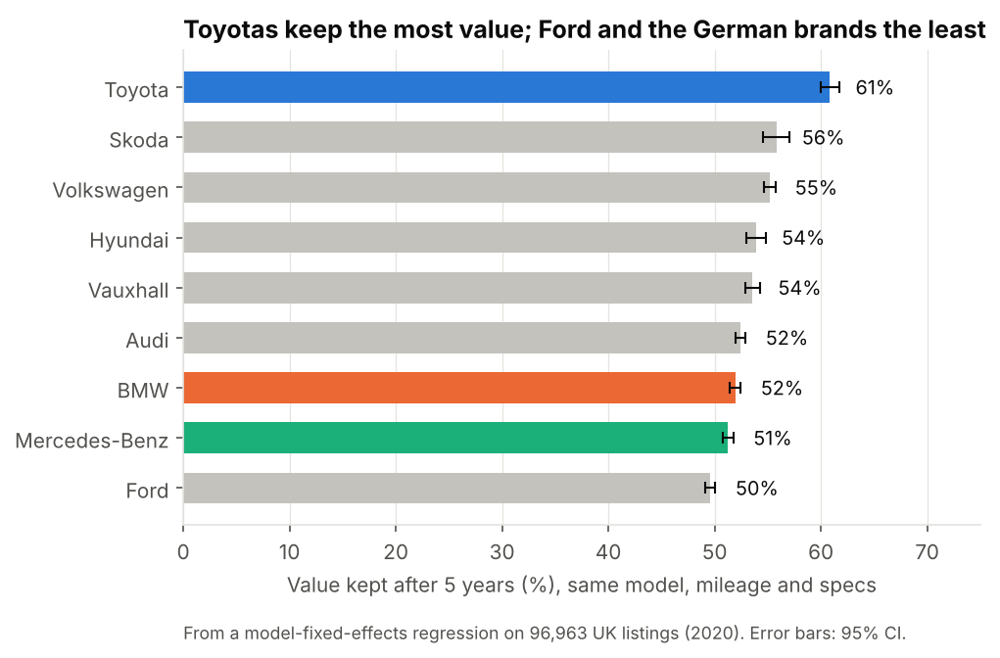
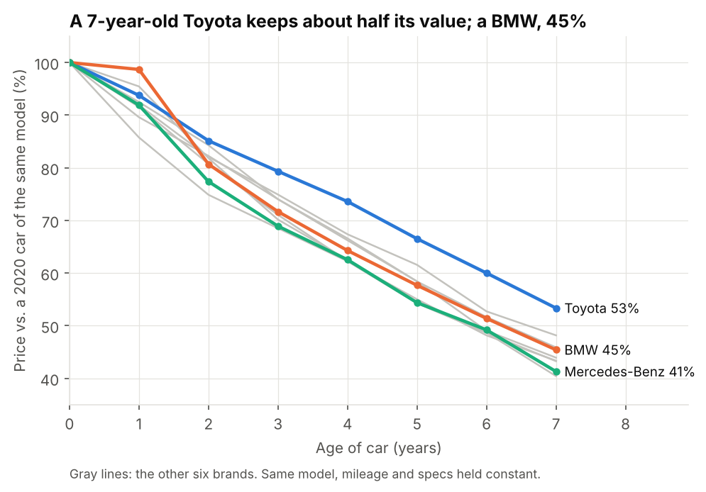

# Used Car Prices: Which Brands Hold Their Value?

**Do BMWs really lose value faster than Toyotas, and how well can a model price a used car?** This project answers both questions with about 97,000 real used car listings from the UK.



## Key findings

**1. Toyota holds its value best; Ford and the German luxury brands lose it fastest.** Comparing cars of the same model with the same mileage and specs:

| Brand | Value kept per year | After 3 years | After 5 years |
|---|---|---|---|
| Toyota | 90.5% | 74% | 61% |
| Skoda | 89.0% | 70% | 56% |
| Volkswagen | 88.8% | 70% | 55% |
| Hyundai | 88.4% | 69% | 54% |
| Vauxhall | 88.3% | 69% | 54% |
| Audi | 87.9% | 68% | 52% |
| BMW | 87.7% | 68% | 52% |
| Mercedes-Benz | 87.5% | 67% | 51% |
| Ford | 86.9% | 66% | 50% |

A gap of three percentage points a year sounds small, but it compounds: after five years a Toyota keeps about 61% of its value and a BMW about 52%.

**2. A gradient-boosted model prices cars to within about £1,060 (6.5%) on average**, roughly half the error of pricing by comparable listings:

| Model | Mean abs. error | Median abs. error | Mean % error | R² |
|---|---|---|---|---|
| Baseline: median of same brand, model and year | £2,113 | £1,255 | 13.0% | 0.833 |
| Ridge regression | £1,627 | £1,058 | 9.5% | 0.914 |
| **Gradient-boosted trees** | **£1,060** | **£694** | **6.5%** | **0.960** |

Evaluated once on a held-out 20% test set (19,489 listings), with settings chosen by 3-fold cross-validation on the training set.



## Approach

**Depreciation.** Comparing average prices by age would be misleading, because brands sell different mixes of cars (Mercedes-Benz's listings include the G-Class; Toyota's are mostly Yarises and Aygos) and older cars have more miles. So the analysis uses a **fixed-effects regression**:

`log(price) = model effect + brand-specific age slope + mileage + engine size + fuel + transmission`

The model effect means each car is only compared with cars of the same model. The brand's age slope converts to "share of value kept per year". Standard errors are heteroskedasticity-robust. A second version with a separate effect for each brand and age checks that depreciation really is close to a constant percentage per year, and it is from year 2 onward.

**Pricing.** The model predicts log price, so errors count as percentages during training (a £1,000 miss matters more on a £5,000 car). It is compared against a simple "median of similar listings" baseline and a linear model, tuned with cross-validation, and evaluated once on the test set. Error analysis looks at accuracy by brand and price band and at the biggest misses; permutation importance shows which features the model relies on.

**Data cleaning.** 1,742 of 99,187 rows (1.8%) were removed: 1,475 exact duplicate listings, 266 non-electric cars with a 0-litre engine (a missing value recorded as 0), and one car listed as a 2060 model.

## Limitations

- **Asking prices, not sale prices**, from a single 2020 snapshot of the **UK** market.
- **Cross-sectional depreciation**: cars of different ages are compared at the same moment, not the same car tracked over time.
- **No condition or trim data**, which explains much of the remaining error, especially on old, cheap cars.

## Repository structure

```
used-car-price-depreciation/
├── data/raw/                 # one CSV per brand (original files)
├── notebooks/
│   └── used_car_price_depreciation.ipynb   # full analysis with outputs
├── src/
│   ├── data.py               # loading and cleaning rules
│   ├── depreciation.py       # fixed-effects depreciation model
│   └── modeling.py           # baseline, ridge, gradient boosting, metrics
├── tests/test_pipeline.py    # unit tests, incl. recovering known depreciation rates from simulated data
├── reports/figures/
└── requirements.txt
```

## How to run

```bash
git clone https://github.com/kennethpangestu/used-car-price-depreciation.git
cd used-car-price-depreciation
python -m venv .venv && source .venv/bin/activate   # Windows: .venv\Scripts\activate
pip install -r requirements.txt

pytest
jupyter lab notebooks/used_car_price_depreciation.ipynb
```

## Data

"100,000 UK Used Car Data set" (listings scraped in 2020), published on Kaggle by Aditya Desai. See [`data/README.md`](data/README.md).
